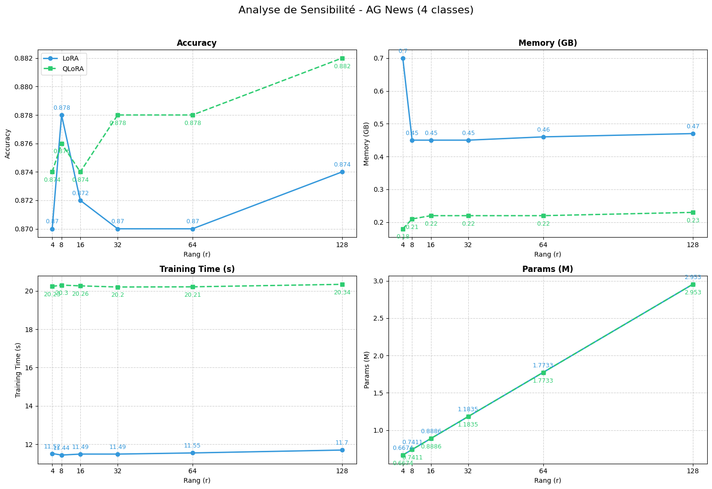
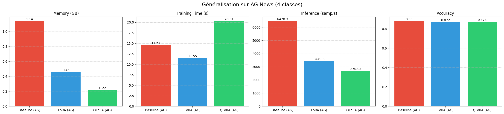

# LoRA vs QLoRA: parameter-efficient fine-tuning benchmark

Benchmark of three fine-tuning strategies for a transformer classifier: **full fine-tuning**, **LoRA** and **QLoRA** (LoRA on a 4-bit NF4-quantized model), compared on accuracy, GPU memory, training time and inference speed, using Hugging Face PEFT.

## Key results (AG News, 4-class topic classification)

| Method                      | Accuracy | Trainable params | Peak training memory* | Training time |
|-----------------------------|:--------:|:----------------:|:---------------------:|:-------------:|
| Full fine-tuning            | 0.880    | 66.96 M (100 %)  | 1.14 GB               | 14.7 s        |
| LoRA (r = 16)               | 0.872    | 0.89 M (1.3 %)   | 0.46 GB               | 11.6 s        |
| QLoRA (4-bit NF4, r = 16)   | 0.874    | 0.89 M (1.3 %)   | 0.22 GB               | 20.3 s        |

\* Additional peak GPU memory allocated during training, on top of the loaded model.

**Takeaways**

- LoRA and QLoRA stay within **1 accuracy point** of full fine-tuning while training **~1.3 % of the parameters**.
- QLoRA cuts training memory by **~80 %** (1.14 → 0.22 GB), at the cost of **~1.8× slower training** than LoRA, due to on-the-fly dequantization of the 4-bit weights.
- Inference is also slower with QLoRA (~2,700 vs ~3,450 samples/s for LoRA): quantization is a memory trade-off, not a speed one.
- Varying the LoRA rank from 4 to 128 barely changes memory or training time. Accuracy stays between 0.870 and 0.882, which is within the noise of a 500-example evaluation set, so no rank clearly wins here.





## Experiments

| | IMDB | AG News |
|---|---|---|
| Task | Binary sentiment | 4-class topic (World, Sports, Business, Sci/Tech) |
| Train / eval size | 9,500 / 500 | 2,000 / 500 |
| Rank study | r ∈ {4, 8, 16, 32, 64, 128} | r ∈ {4, 8, 16, 32, 64, 128} |

**Setup**

- Base model: `distilbert-base-uncased-finetuned-sst-2-english` (67 M parameters)
- LoRA applied to the attention query and value projections (`q_lin`, `v_lin`), α = 2r, dropout 0.1
- QLoRA: 4-bit NF4 quantization with bitsandbytes, fp16 compute, classification head kept in full precision
- 1 epoch, batch size 16, fp16 mixed precision, max sequence length 256
- Hardware: Google Colab, NVIDIA T4 (16 GB)

## Repository structure

```
.
├── notebook.ipynb     # full experiment pipeline (data, benchmark class, runs, plots)
├── report.pdf         # project report (in French)
├── requirements.txt
└── assets/            # result figures
```

## How to run

```bash
pip install -r requirements.txt
jupyter notebook notebook.ipynb
```

A CUDA GPU is required for the QLoRA runs (bitsandbytes). A free Colab T4 is enough.

## Limitations and next steps

- **IMDB is not a fair test**: the base model was already fine-tuned on SST-2 sentiment, so it performs well on IMDB before any training. AG News, where the classification head is re-initialized, is the meaningful benchmark.
- **Single seed, small eval sets**: differences below ~1.5 accuracy points are not significant. Next step: average over several seeds and report confidence intervals.
- **Small model**: the memory savings of QLoRA matter most on large models (7B+). Next step: reproduce the benchmark on a decoder LLM (e.g. a 1–3B model) for a generation task.
- **Memory measurement**: the metric covers the extra memory allocated during training, not the model weights themselves. Measuring total peak memory would give a more complete picture.

## Context

Individual project for the *Large Language Models* course, MSc Computer Science – MIND, Sorbonne University (2025–2026).

**Stack:** Python · PyTorch · Hugging Face Transformers · PEFT · bitsandbytes · Datasets
